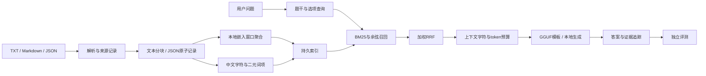

# 设计说明

沿用旧项目离线建库与在线问答两条流程，把小说限定处理改为通用文档处理。C++17 核心模块与 llama.cpp 后端隔离，使用 `RAG_WITH_LLAMA=OFF` 可以独立测试数据与检索。

| 模块 | 职责 |
| --- | --- |
| `Config` / `Logger` | 沿用现有配置和日志入口，补充参数验证，日志写 stderr |
| `Text` | 严格 UTF-8、中文词项、选项识别、模型标识、原子 JSON 保存 |
| `DocumentProcessor` | 文件适配、结构边界、空记录检查和来源 metadata |
| `Index` | BM25 倒排索引、余弦召回、加权 RRF、持久化与校验 |
| `Inference` | 后端/模型/上下文/批次/采样器 RAII，本地嵌入及生成 |
| `Evaluation` | 只返回题号和题干给推理；生成结束后独立读取标准答案及依据编号 |
| `main` | 建库、检索、交互问答、批量检查点、结果导出 |

## 文档和索引

TXT/Markdown 的分块单位为 Unicode 字符，避免旧流程按字节限制对中文造成误解。章节标题成为 metadata，重叠保留局部上下文。JSON 文档记录作为完整证据，不跨记录拼接；长记录按嵌入 token 上限拆窗口并聚合，但保存原文和稳定记录 ID。

数据库保存格式版本、tokenizer 版本、嵌入模型标识、来源、记录 ID、正文和向量。正文/向量校验和检查意外损坏，加载时拒绝混合维度、非有限向量和重复 chunk ID。FNV 校验和是损坏检测工具，不是加密签名。模型标识由规范路径、大小、修改时间和头部指纹构成，并附嵌入窗口算法与参数，切换模型或窗口后要求重新建库。

增量建库复用 ID、正文、标题和模型标识相同的向量。完整输入清单生成新索引，再原子替换旧文件；缺失文档会被移除，不发生半更新。

## 检索

英文和数字按连续词项处理，中文采用字符与相邻二元词项，单字权重降低。BM25 使用倒排列表、文档频率和长度归一化。常规问题召回一次；选择题额外检索题干及每个选项，所有选项使用相同权重。这个过程只处理输入文本，不查看正确答案。

余弦检索使用本地向量，RRF 按排名融合，避免直接相加不同尺度的 BM25 分数和余弦值。向量权重可配置，以适应模型和语料。召回数量不代表证据完整性，必须通过题集规则标注或人工审核检查；多个规则联合判断是本次评测的重要维度。

## 生成与追踪

使用模型内置 chat template，按实际 token 数保留问题和输出预算。低排名证据优先退出上下文；最后一条过长时裁剪并记录实际提供文本。原始检索证据保存在 `evidence`，实际提供给模型的文本保存在 `trace.context_text`，两者的用途不同。

开放问答请求证据编号引用；选择题使用根据选项标签生成的 GBNF 语法，输出一个标签，避免把“分析里提到的 A”误解析为最终答案。语法不提供标准答案，也不验证推理正确性。

每题记录耗时、prompt token 数、生成 token 数、来源、状态和错误。批量运行遇到单题错误继续处理其他题，最终返回非零退出码。逐题 JSONL 刷盘，定期生成 JSON 快照；续跑核对索引、配置、模式、模型和问题指纹，失败题重试，损坏尾行可恢复。模型源码变化目前不自动进入实验指纹；升级二进制后建议使用新的输出路径。

## 验证和限制

核心测试覆盖 UTF-8 合法性、中文选项、章节切分、记录边界、拒绝题目入库、中文 BM25、校验损坏、向量维度和多依据指标。另用真实本地 GGUF 验证嵌入、选择题、通用文档问答及完整验证集。

索引适用于当前千条记录级别，向量通道为 O(ND) 线性扫描。嵌入窗口均值、模型上下文裁剪和小模型推理能力都可能影响准确率。领域术语映射、版本冲突判断、独立重排器和会话记忆属于后续可扩展模块，目前没有宣称实现。
